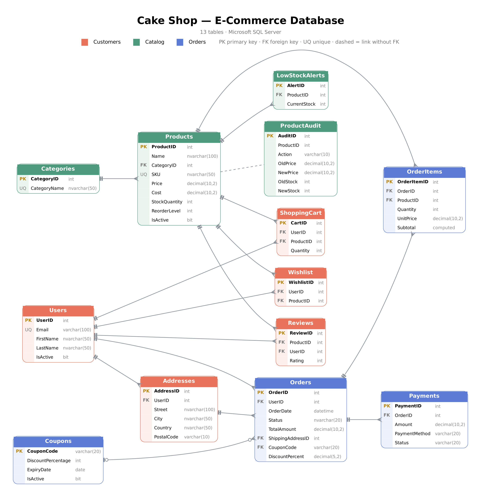

# Cake Shop: E-Commerce Database (SQL Server)

Database for an online cake shop: customers, products, cart, orders, coupons,
payments, reviews and stock control. Written in T-SQL for Microsoft SQL Server (SSMS).



## Files

| File | Contents |
|---|---|
| `01_schema.sql` | Database, 13 tables, constraints, indexes |
| `02_views_functions.sql` | 2 functions, 4 views |
| `03_procedures.sql` | 11 stored procedures |
| `04_triggers.sql` | 4 triggers |
| `05_test_data.sql` | Sample data: 26 users, 55 products, 46 orders, 107 order items, 42 reviews |
| `06_queries.sql` | 18 practice tasks: JOIN, GROUP BY / HAVING, subqueries, CTE, window functions |


## How to run

In SSMS run the files in order: `01` → `02` → `03` → `04` → `05` (once), then `06` .

## How an order works

```
sp_AddToCart     -> checks stock, adds to ShoppingCart
sp_ProcessOrder  -> creates Orders + OrderItems, empties the cart
    trg_OrderItems_UpdateInventory -> reduces stock, writes LowStockAlerts
    trg_OrderItems_UpdateTotal     -> calculates Orders.TotalAmount (with discount)
sp_ApplyDiscount -> applies a coupon (active, not expired, one per order)
sp_CancelOrder   -> only Pending / Processing orders; returns the stock
```

Stock is reduced in **one place only** (the trigger), and the order total is calculated
in **one place only** (the trigger).

## Objects

**Procedures:** `sp_RegisterUser`, `sp_LoginUser`, `sp_GetUserProfile`, `sp_UpdateProduct`,
`sp_UpdateInventory`, `sp_AddToCart`, `sp_ProcessOrder`, `sp_ApplyDiscount`,
`sp_CancelOrder`, `sp_GetUserOrders`, `sp_AddReview`

**Triggers:**

| Trigger | When | What it does |
|---|---|---|
| `trg_OrderItems_UpdateInventory` | after INSERT on OrderItems | reduces stock, low stock alert |
| `trg_OrderItems_UpdateTotal` | after INSERT / UPDATE / DELETE on OrderItems | recalculates order total |
| `trg_Products_Audit` | after UPDATE on Products | saves old and new price / stock |
| `trg_Products_DeleteProtection` | instead of DELETE on Products | sets `IsActive = 0` instead of deleting |

**Views:** `vw_SalesReport`, `vw_ProductAnalytics`, `vw_LowStockProducts`, `vw_CustomerActivity`

**Functions:** `fn_CalculateDiscountedPrice`, `fn_GetCustomerPurchases`

## Notes

- Prices are `DECIMAL(10,2)` in AMD. `OrderItems.UnitPrice` keeps the price at order time.
- Names are `NVARCHAR` (Armenian / Russian letters), `PostalCode` is text (`0010`).
- Products are never deleted, because old orders reference them.
- All emails and phones in the test data are fake (`@example.com`).
